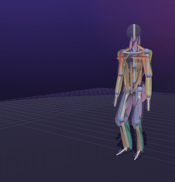
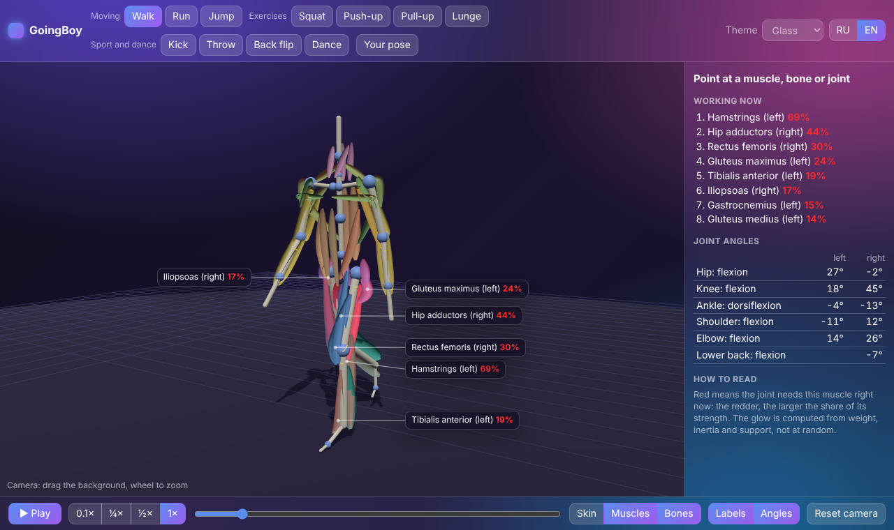
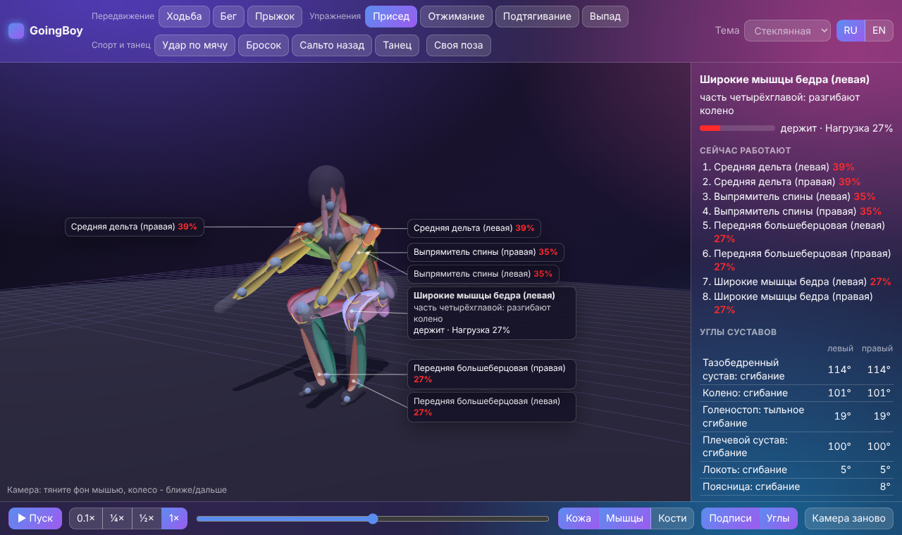
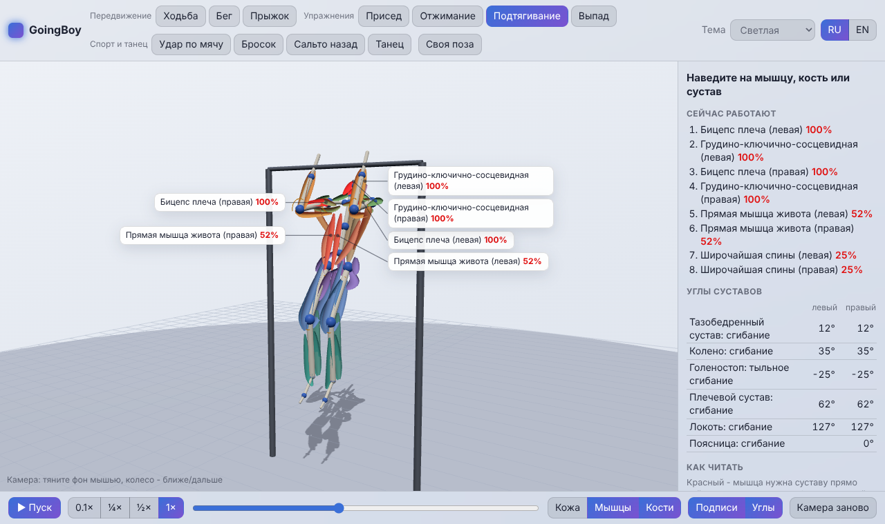
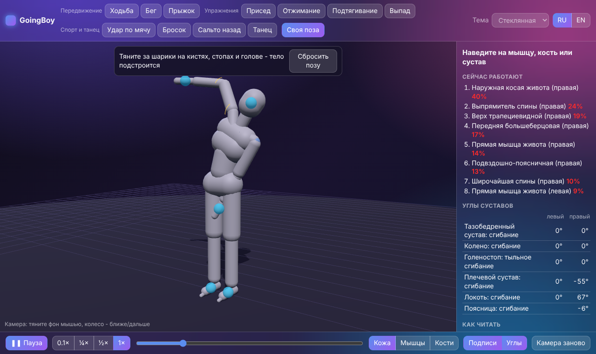
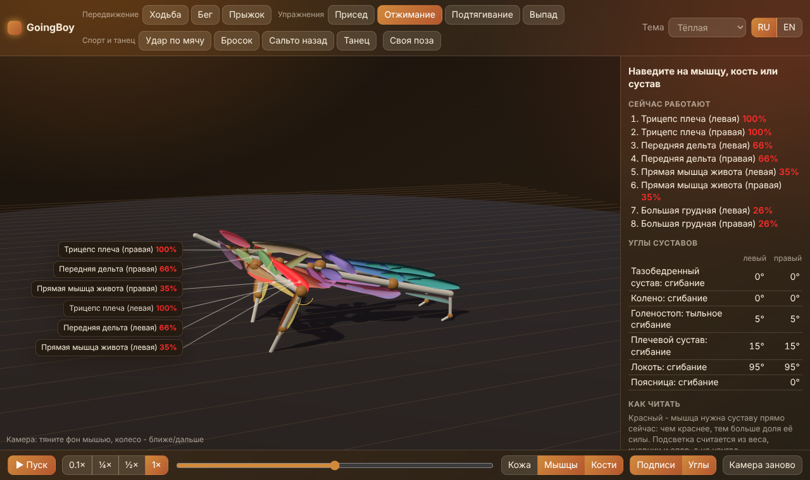
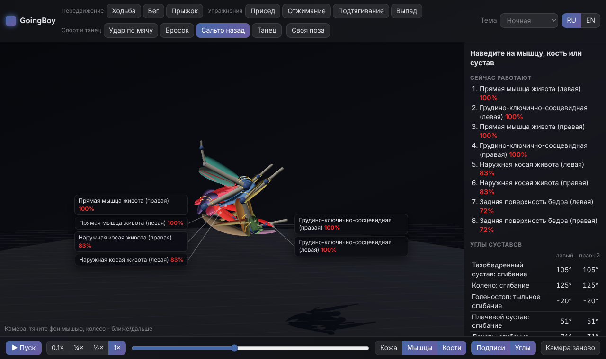
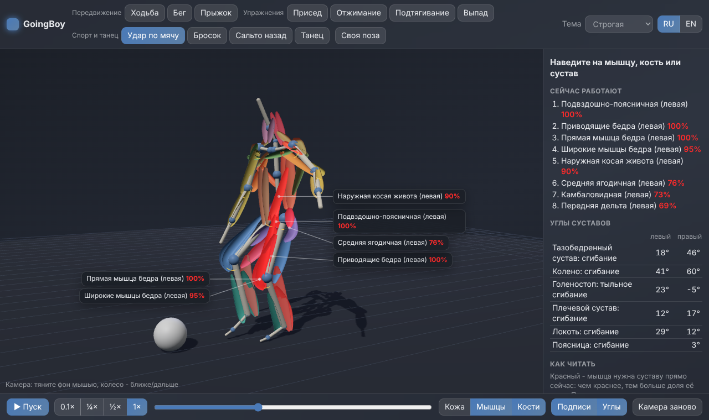
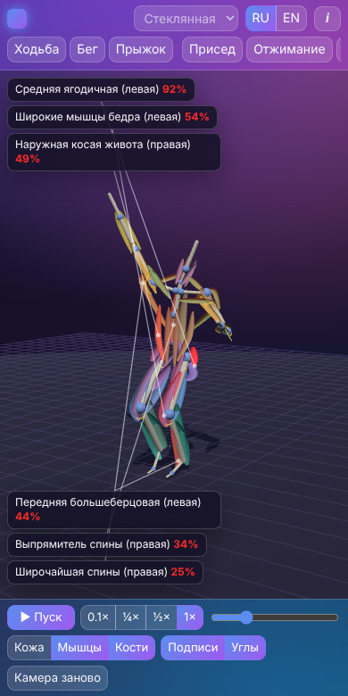

# GoingBoy

**English** · [Русский](README.ru.md)

[](CHANGELOG.md) [](https://github.com/ALEXalesha/GoingBoy/actions/workflows/ci.yml) [](LICENSE) [](https://developer.mozilla.org/docs/Web/JavaScript) [](https://threejs.org/) [](https://www.electronjs.org/) [](https://alexalesha.github.io/GoingBoy/) [](https://claude.com/claude-code)

Code, tests and docs were written by Claude (Anthropic) in Claude Code; ideas, testing and decisions are Alexey's.

A demo of how the human body moves. A stylized figure walks, runs, squats, does a back flip or
dances, and you see which joints, bones and muscles do the work. Not a game - an interactive
anatomy of movement, in the browser and as a desktop app.





| Squat, hover on a muscle | Pull-up, light theme | Your own pose |
| --- | --- | --- |
|  |  |  |

| Push-up, warm theme | Back flip, night theme | Kick, formal theme | Phone |
| --- | --- | --- | --- |
|  |  |  |  |

## What it shows

- **11 movements:** walk, run, jump; squat, push-up, pull-up, lunge; kick, throw, back flip, dance.
- **Your own pose:** drag a hand, a foot or the head - the limb follows by inverse kinematics,
  joints never bend past their limits, nothing goes into the floor.
- **Layers:** skin, muscles, bones - any combination.
- **Muscle work:** 25 main muscles on each side (50 bands). A muscle turns red when a joint needs
  its pull right now. The glow is computed, not random: weight, inertia and support give the
  torque at each joint, and the torque is shared by the muscles whose lever arm has the same sign.
- **Joints show their angles** (arcs on the body, a table in the side panel).
- **Labels on hover:** name, what the muscle does and what it is doing now (shortening, holding
  or braking). Labels stand beside the body with leader lines and never cover it.
- **Slow motion** (0.1×-1×), pause, frame scrubbing, free camera.
- 5 themes (as in PaintPro), Russian and English.

## Controls

| Action | Mouse / keys |
| --- | --- |
| Turn the camera | drag the background; double click resets |
| Zoom | mouse wheel, two fingers |
| Pause / play | Space or the button |
| One frame back / forward (paused) | ← → |
| Your pose | "Your pose", then drag the blue balls |

## Run

- **Browser:** open `web/index.html` (works straight from disk) or the
  [website](https://alexalesha.github.io/GoingBoy/) once GitHub Pages is on.
- **Desktop app:** `npm install`, then `npm start` (Electron). `npm run dist` builds a Windows
  installer and a portable exe.

## Tests

```bash
npm test                 # laws of the core (node:test)
npm run coverage         # same with branch coverage: core >= 90 %, all non-window code >= 80 %
npm run test:web         # the page in headless Chromium (Playwright)
xvfb-run -a npm run test:app   # the Electron app, 20 launches without memory growth
npm run mutate           # mutants: every law must catch its own breakage
```

Laws are checked on every frame of every movement: joint angles within anatomy, bone lengths
constant, nothing under the floor, support feet do not slide, the body is balanced in static
moves, the centre of mass flies on a parabola in the air, each muscle's lever arm agrees with
what its label says, the glow agrees with the joint torque, labels never overlap each other or
the body.

## How it is built

`web/js/core` - pure rules without a window (kinematics, animation, IK, load, label layout),
`web/js/body` - the body model (skeleton, muscles, the code-built figure), `web/js/app` - the
window. The figure will later be replaced by a model made in Blender with the same bone names;
the contract is in [docs/body-model.md](docs/body-model.md).

## License

MIT
