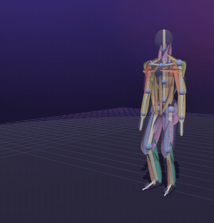
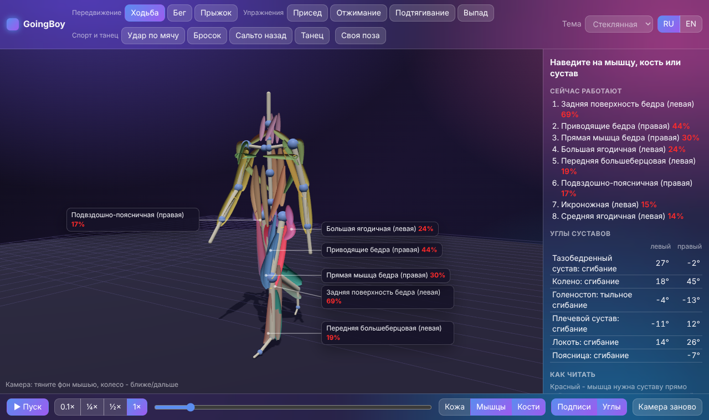
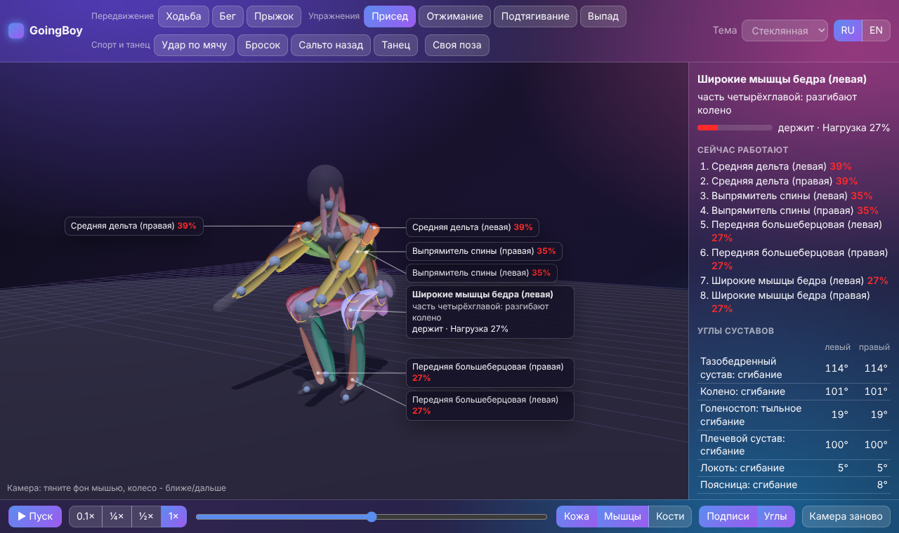
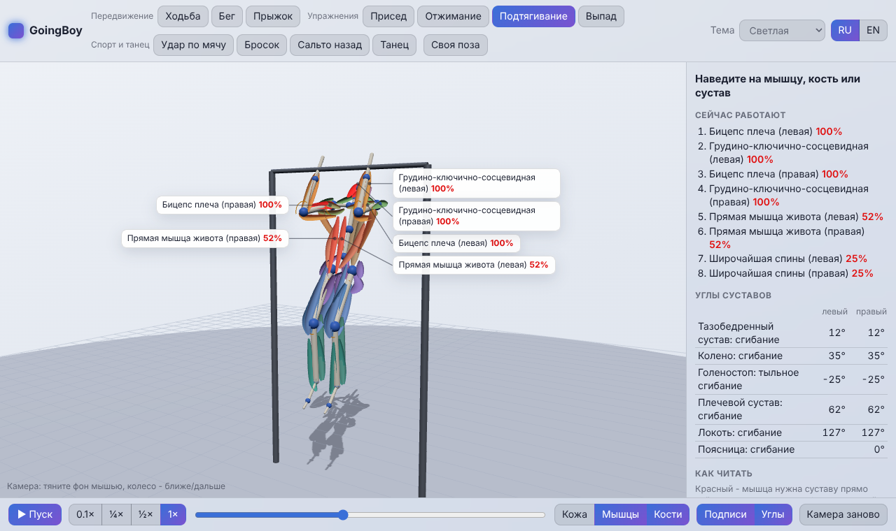
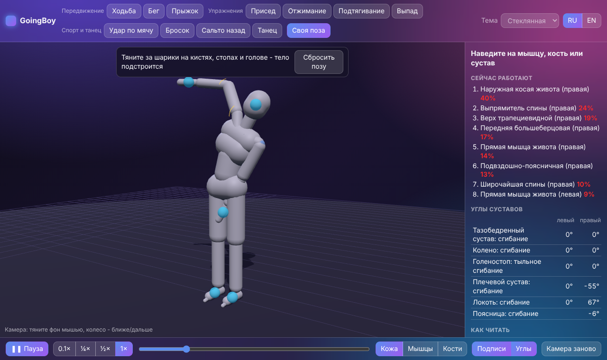
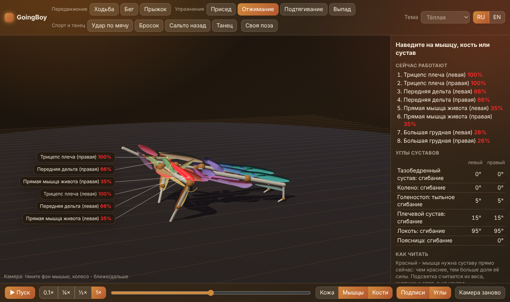
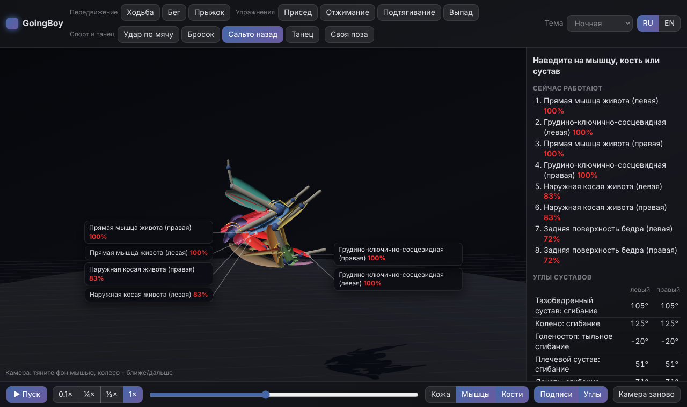
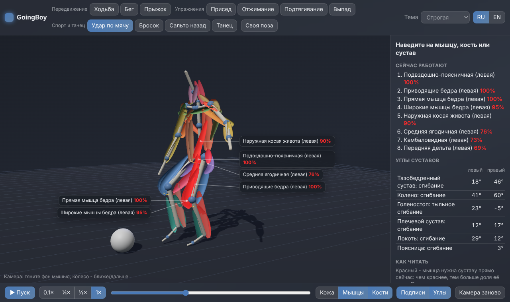
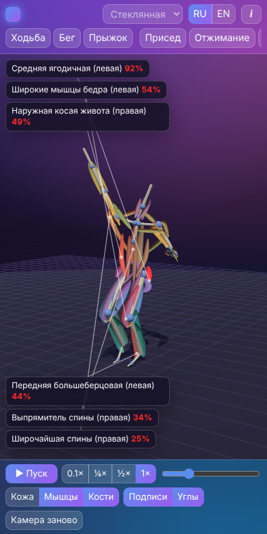

# GoingBoy

[English](README.md) · **Русский**

[](CHANGELOG.md) [](https://github.com/ALEXalesha/GoingBoy/actions/workflows/ci.yml) [](LICENSE) [](https://developer.mozilla.org/docs/Web/JavaScript) [](https://threejs.org/) [](https://www.electronjs.org/) [](https://alexalesha.github.io/GoingBoy/) [](https://claude.com/claude-code)

Код, тесты и документацию написал Claude (Anthropic) в Claude Code; идеи, проверка и решения - Алексея.

Демка движений человеческого тела. Стилизованный человечек ходит, бегает, приседает, делает
сальто или танцует, и видно, какие суставы, кости и мышцы при этом работают. Не игра, а
наглядная анатомия движения - в браузере и отдельной программой.





| Присед, подпись под мышью | Подтягивание, светлая тема | Своя поза |
| --- | --- | --- |
|  |  |  |

| Отжимание, тёплая тема | Сальто, ночная тема | Удар по мячу, строгая тема | Телефон |
| --- | --- | --- | --- |
|  |  |  |  |

## Что показывает

- **11 движений:** ходьба, бег, прыжок; присед, отжимание, подтягивание, выпад; удар по мячу,
  бросок, сальто назад, танцевальная связка.
- **Своя поза:** тянешь кисть, стопу или голову - конечность идёт за мышью (обратная
  кинематика), суставы не выворачиваются за свои пределы, в пол ничего не уходит.
- **Слои:** кожа, мышцы, кости - в любом сочетании.
- **Работа мышц:** 25 главных мышц с каждой стороны (50 лент). Мышца краснеет, когда суставу
  прямо сейчас нужна её тяга. Подсветка считается, а не горит наугад: из веса, инерции и опор
  получается момент в каждом суставе, и его делят мышцы, у которых плечо того же знака.
- **Суставы показывают угол:** дуги на теле и таблица в боковой панели.
- **Подписи при наведении:** название, что мышца делает и что она делает сейчас (сокращается,
  держит или тормозит). Подписи стоят сбоку от тела с выносками и не закрывают его.
- **Замедление** (0.1×-1×), пауза, перемотка по кадрам, свободная камера.
- 5 тем (как в PaintPro), русский и английский.

## Управление

| Действие | Мышь / клавиши |
| --- | --- |
| Повернуть камеру | тянуть фон; двойной щелчок - на место |
| Ближе / дальше | колесо мыши, два пальца |
| Пауза / пуск | пробел или кнопка |
| Кадр назад / вперёд (на паузе) | ← → |
| Своя поза | «Своя поза», потом тянуть голубые шарики |

## Запуск

- **Браузер:** открыть `web/index.html` (работает прямо с диска) или
  [сайт](https://alexalesha.github.io/GoingBoy/), когда включат GitHub Pages.
- **Программа:** `npm install`, потом `npm start` (Electron). `npm run dist` собирает установщик
  для Windows и переносную версию.

## Проверки

```bash
npm test                 # законы ядра (node:test)
npm run coverage         # то же с покрытием по ветвям: ядро >= 90 %, весь код без окон >= 80 %
npm run test:web         # страница в headless Chromium (Playwright)
xvfb-run -a npm run test:app   # программа Electron, 20 запусков без роста памяти
npm run mutate           # мутанты: каждый закон обязан поймать свою поломку
```

Законы проверяются на каждом кадре каждого движения: углы суставов в пределах анатомии, длина
костей постоянна, ничего не уходит под пол, опорная стопа не скользит, в статичных упражнениях
тело в равновесии, в полёте центр масс летит по параболе, плечо каждой мышцы согласно с её
подписью, подсветка согласна с моментом в суставе, подписи не налезают друг на друга и на тело.

## Как устроено

`web/js/core` - чистые правила без окна (кинематика, анимация, IK, нагрузка, раскладка подписей),
`web/js/body` - модель тела (скелет, мышцы, человечек кодом), `web/js/app` - окно. Позже
человечка заменит модель из Blender с теми же именами костей; договор - в
[docs/body-model.md](docs/body-model.md).

## Лицензия

MIT
